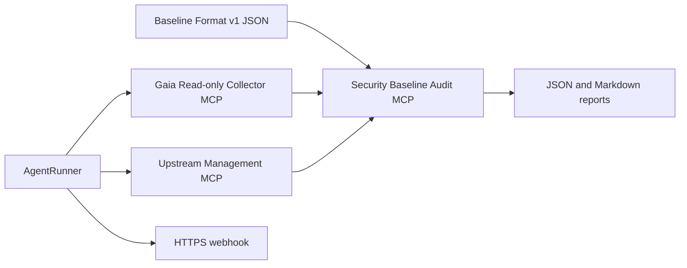

# Experimental Read-only Audit Extension

## Status and ownership

This extension is community-developed work in a fork of the Check Point MCP Servers repository. It is not part of the upstream project, is not an official Check Point product, and is not endorsed or supported by Check Point Software Technologies Ltd.

The upstream source remains covered by its existing MIT license and copyright notice. Keep the repository `LICENSE` file and original notices when redistributing the fork.

## Why this extension exists

The upstream Gaia and Management MCP servers make Check Point product capabilities available to AI clients. That is useful for interactive investigation and administration, but unattended auditing needs a smaller and more deterministic operating boundary:

1. A scheduled process cannot answer interactive credential prompts.
2. A read-only audit should not expose unrelated write operations to the agent.
3. Compliance decisions should be reproducible code, not an unconstrained language-model judgment.
4. Operations need retries, locking, history, reports, exit codes, and notification routing outside the audit evaluator.

The extension separates those responsibilities into collection, evaluation, and orchestration components.

## Architecture

### Gaia Read-only Collector MCP

Package: `packages/gaia-readonly-collector`

- Exposes only `show_dns`, `show_dhcp`, and `show_date_time`.
- Rejects targets not listed in `GAIA_ALLOWED_TARGETS`.
- Requires TLS certificate verification and supports a configured CA file.
- Resolves credentials from process environment profiles rather than MCP arguments.
- Provides no generic endpoint, arbitrary CLI, or configuration-write operation.

### Security Baseline Audit MCP

Package: `packages/baseline-audit`

- Accepts normalized observations or raw MCP responses.
- Validates strict Baseline Format v1 documents and rejects unknown fields.
- Supports organization-authored baselines through a non-executable declarative assertion language.
- Bundles only an independently authored example baseline; third-party benchmark content is not included.
- Produces deterministic `PASS`, `FAIL`, `MANUAL`, `ERROR`, and `EXEMPTED` results.
- Persists audit history and reports regressions and improvements.
- Supports scoped, expiring exceptions without converting them into passes.
- Does not connect to or modify a Check Point system itself.
- Treats remediation action IDs as inert metadata for a separate future executor.

### Baseline Audit Runner

Package: `packages/baseline-audit-runner`

- Starts MCP servers over stdio and audits enabled targets with bounded concurrency.
- Requires a Baseline Format v1 JSON file with an explicit `inputs` list.
- Starts only the Gaia and Management collectors declared by the baseline `inputs` list.
- Passes target-specific non-secret parameters to the baseline evaluator.
- Retries failed attempts and prevents overlapping runs for the same target.
- Writes timestamped JSON and Markdown reports.
- Sends a minimal HTTPS webhook summary for configured result statuses.
- Includes Windows Task Scheduler and DPAPI credential-loading templates.

## Security boundary

This project starts with read-only auditing rather than automated remediation. The main controls are:

- Fixed Collector tools instead of arbitrary Gaia API access.
- Exact target allowlisting.
- TLS verification with no insecure bypass option.
- Explicit environment-variable forwarding between processes.
- No credentials in MCP arguments, reports, fixtures, or sample configuration values.
- Deterministic evaluation independent of an LLM.
- Strict baseline validation and no executable expressions, scripts, network references, or file references.
- Remediation metadata is not executable by the audit MCP or Runner.
- Separate scheduling and notification from evidence evaluation.

Automated configuration should be implemented later as a separate component with explicit approval, a per-control operation allowlist, pre-change backup, post-change verification, and rollback behavior.

## Validation status

The following checks do not require a Check Point device and have been completed:

- Gaia Read-only Collector tests: 8 passing.
- Security Baseline Audit MCP unit and stdio integration tests.
- Baseline Audit Runner unit and fixture integration tests.
- Real stdio MCP client/server exchanges.
- Fixture audit using the independently authored organization baseline example.
- Organization-authored baseline evaluation and input-driven Collector selection.
- Monorepo package builds, configuration validation, report generation, and PowerShell syntax checks.

The following require a lab or production-approved Check Point environment:

- Gaia API response fields and version differences.
- Minimum service-account permissions for each read operation.
- Management API pagination against a large real rulebase.
- CA chain and hostname validation.
- Session expiration and reauthentication behavior.
- Audit accuracy against real policy and device configurations.

## Baseline content

This repository does not include third-party benchmark publications or derived control definitions. The supplied organization example is independently authored to demonstrate the format and engine.

Users who load external baseline content are responsible for obtaining it lawfully, complying with its license and trademark terms, and validating that the implemented assertions accurately represent their intended policy. An audit result is evidence from the supplied observations, not a product certification.

## Publishing this fork

Before making the fork public:

1. Keep the upstream `LICENSE` and copyright notice.
2. Identify the fork as community-developed and unofficial in the repository description and README.
3. Do not include third-party benchmark publications, production reports, credentials, CA private keys, DPAPI files, or real target configuration.
4. Use documentation-only IP ranges and synthetic fixtures.
5. Run secret scanning, tests, builds, and dependency review in CI.
6. Keep fork-owned packages private until a separate npm publication and naming review is complete.
7. Disable upstream release automation and use fork-owned test and build workflows.

For an upstream contribution, follow the upstream contribution process and let the maintainers decide package naming, scope, ownership, and product positioning.
